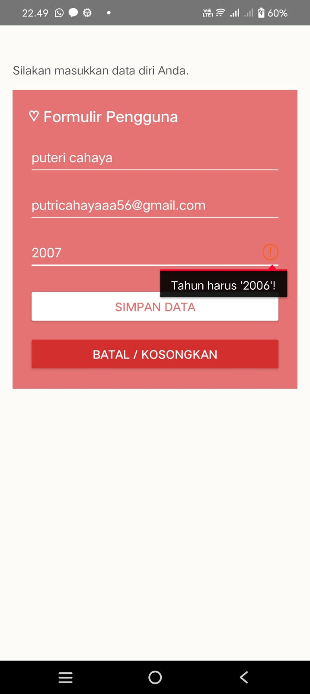
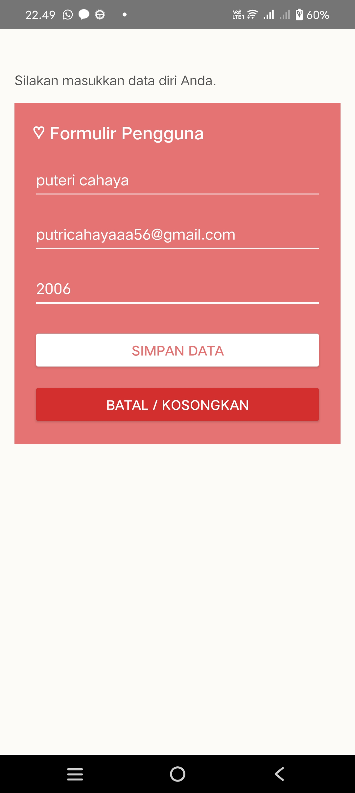
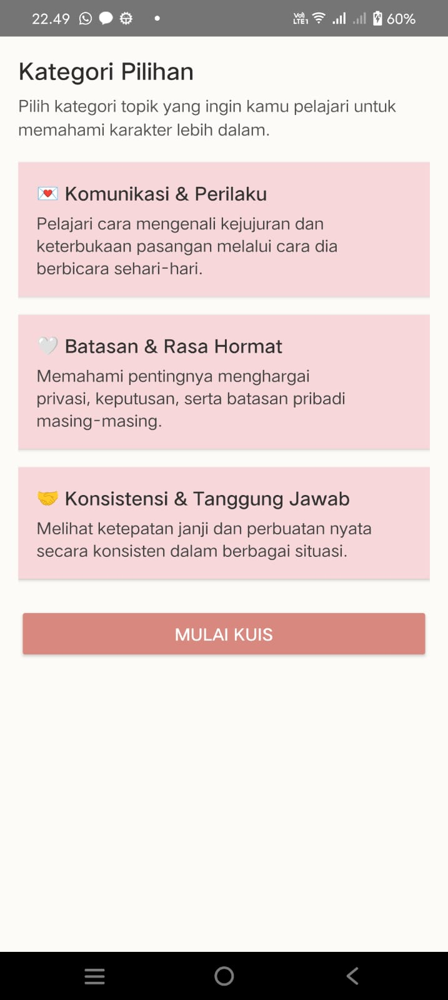
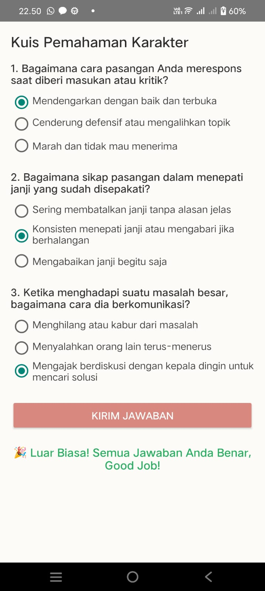

# Mengenal Karakter Seseorang (Aplikasi Mobile)

Aplikasi berbasis Android yang dikembangkan menggunakan Kotlin dan Android Studio untuk membantu mengenali berbagai tipe karakter dan kepribadian seseorang melalui serangkaian tes atau informasi interaktif[span_0](start_span)[span_0](end_span)[span_1](start_span)[span_1](end_span). Aplikasi ini dirancang untuk tugas pemrograman mobile guna mempelajari navigasi multi-layar, lifecycle, transfer data antar Activity, serta penanganan validasi input dinamis[span_2](start_span)[span_2](end_span)[span_3](start_span)[span_3](end_span).

## 📱 Fitur & Layar Aplikasi

1. **Layar 1 (Beranda):** Halaman utama untuk memasukkan nama, identitas pengguna, dan memulai eksplorasi karakter[span_4](start_span)[span_4](end_span)[span_5](start_span)[span_5](end_span).
2. **Layar 2 (Validasi Input / Error State):** Tampilan validasi input interaktif jika kolom kosong atau tidak sesuai format[span_6](start_span)[span_6](end_span)[span_7](start_span)[span_7](end_span).
3. **Layar 3 (Kategori Karakter):** Halaman yang menampilkan sapaan nama pengguna secara dinamis (*Intent Extra*) serta pilihan kelompok atau tipe kepribadian[span_8](start_span)[span_8](end_span)[span_9](start_span)[span_9](end_span).
4. **Layar 4 (Detail Karakter):** Halaman detail lengkap mengenai ciri-ciri, kelebihan, kekurangan, serta tips menghadapi karakter tersebut[span_10](start_span)[span_10](end_span)[span_11](start_span)[span_11](end_span).

## 🛠️ Komponen & Teknologi yang Digunakan

* **Bahasa & Framework:** Kotlin, XML Layouts / Jetpack Compose[span_12](start_span)[span_12](end_span)[span_13](start_span)[span_13](end_span)
* **Komponen Utama:** Activity Lifecycle, Intent Data Passing, Custom Validation[span_14](start_span)[span_14](end_span)
* **Resource Management:** `strings.xml`, `colors.xml`[span_15](start_span)[span_15](end_span)

## 🚀 Cara Menjalankan Aplikasi (Langsung di HP)

1. **Persiapan HP:**
   * Aktifkan *Developer Options (Opsi Pengembang)* di HP Android kamu[span_16](start_span)[span_16](end_span).
   * Aktifkan fitur *USB Debugging* di dalam menu Opsi Pengembang[span_17](start_span)[span_17](end_span).
   * Sambungkan HP ke laptop menggunakan kabel USB[span_18](start_span)[span_18](end_span).
2. **Buka Project di Android Studio:**
   * Buka folder project melalui Android Studio[span_19](start_span)[span_19](end_span).
   * Tunggu proses *Gradle Sync* sampai selesai[span_20](start_span)[span_20](end_span).
3. **Jalankan Aplikasi:**
   * Di bagian atas Android Studio, pastikan perangkat yang dipilih adalah nama HP fisik Anda (bukan emulator)[span_21](start_span)[span_21](end_span)[span_22](start_span)[span_22](end_span).
   * Klik tombol **Run** (ikon play hijau / `Shift + F10`) untuk *build* dan *install* aplikasi secara otomatis langsung ke HP-mu[span_23](start_span)[span_23](end_span)[span_24](start_span)[span_24](end_span).

## 📸 Tangkapan Layar (Screenshot)

| Layar 1 (input invalid) | Layar 2 (input ) | Layar 3 (Kategori) | Layar 4 (Detail Karakter) |
| :---: | :---: | :---: | :---: |
|  |  |  |  |
| *Halaman Beranda* | *Pesan Error* | *Pilihan Kategori* | *Detail Karakter* |
